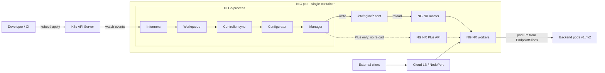

<!-- Generated by scripts/gen-docs.mjs from src/data/*.js. Edit those files, then run `npm run docs`. -->

# Component Reference

What each part of an F5 NGINX Ingress Controller deployment does, from the Kubernetes objects it watches to the NGINX processes that serve traffic. Every command has a worked example: what to type, sample output from the cafe demo cluster, and what to look for. Sample output is illustrative, so names, IPs and ages will differ in your cluster.



**Contents**

- Kubernetes objects
  - [Kubernetes API Server (and etcd)](#api)
  - [Ingress and IngressClass](#ingress)
  - [Service (ClusterIP)](#svc)
  - [EndpointSlice](#endpointslice)
  - [Deployment and backend Pods (v1 / v2)](#pods)
  - [Secret (TLS, JWK, CA)](#secret)
  - [NIC ConfigMap (nginx-config)](#configmap)
  - [NIC Service (LoadBalancer / NodePort) and cloud LB](#lb)
- NIC custom resources (k8s.nginx.org/v1)
  - [VirtualServer](#vs)
  - [VirtualServerRoute](#vsr)
  - [Policy](#policy)
  - [GlobalConfiguration](#gc)
  - [TransportServer](#ts)
- Ingress Controller (IC) process: the Go control plane
  - [Informers and Listers](#informer)
  - [Workqueue (task queue)](#workqueue)
  - [Controller sync handler (LoadBalancerController)](#controller)
  - [Configurator](#configurator)
  - [Manager](#manager)
  - [Status updater and leader election](#status)
  - [Metrics exporter](#exporter)
- NGINX processes and files (inside the same container)
  - [Config files (/etc/nginx)](#conf)
  - [NGINX master process](#master)
  - [NGINX worker processes](#workers)
  - [NGINX Plus REST API and live dashboard](#plusapi)
- Outside the cluster
  - [Developer / CI (kubectl apply)](#developer)
  - [External client](#client)

## Kubernetes objects

Standard Kubernetes resources that NIC watches or depends on.

<a id="api"></a>

### Kubernetes API Server (and etcd)

The front door to the cluster. kubectl and the NIC controller both talk to it. It stores every object in etcd and streams watch events (ADDED, MODIFIED, DELETED) to clients.

NIC never receives manifests directly. It opens watches through the API server for every resource type it cares about, and it writes status back (for example VirtualServer State: Valid and the external IP of an Ingress).

| | |
|---|---|
| **In** | kubectl apply / Helm / GitOps writes |
| **Out** | Watch events to the NIC informers; status updates from NIC |

**Commands** (expand for a worked example)

<details>
<summary><code>kubectl get vs,vsr,ts,policy -A</code></summary>

```bash
$ kubectl get vs,vsr,ts,policy -A
```

Sample output:

```text
NAMESPACE   NAME                                    STATE   HOST               IP             PORTS      AGE
default     virtualserver.k8s.nginx.org/cafe        Valid   cafe.example.com   203.0.113.10   [80,443]   2d
default     virtualserver.k8s.nginx.org/checkout    Valid   shop.example.com   203.0.113.10   [80,443]   5h

NAMESPACE   NAME                                          STATE   HOST               IP             PORTS      AGE
tea-team    virtualserverroute.k8s.nginx.org/tea-vsr      Valid   cafe.example.com   203.0.113.10   [80,443]   2d

NAMESPACE   NAME                                   STATE   REASON          AGE
default     transportserver.k8s.nginx.org/dns      Valid   AddedOrUpdated  3h

NAMESPACE   NAME                                         STATE   AGE
default     policy.k8s.nginx.org/rate-limit-policy       Valid   5h
default     policy.k8s.nginx.org/jwt-policy              Valid   5h
```

**What to look for:** The STATE column is filled in by the IC after it validates each resource. Anything other than Valid (Warning or Invalid) means NGINX is not serving what you applied, so run kubectl describe on it next.

</details>

<details>
<summary><code>kubectl describe vs cafe</code></summary>

```bash
$ kubectl describe vs cafe
```

Sample output:

```text
Name:         cafe
Namespace:    default
API Version:  k8s.nginx.org/v1
Kind:         VirtualServer
Spec:
  Host:  cafe.example.com
  Routes:
    Path:  /coffee
    Splits:
      Action:
        Pass:  coffee-v1
      Weight:  90
      Action:
        Pass:  coffee-v2
      Weight:  10
Status:
  External Endpoints:
    Ip:     203.0.113.10
    Ports:  [80,443]
  Message:  Configuration for default/cafe was added or updated
  Reason:   AddedOrUpdated
  State:    Valid
Events:
  Type    Reason          Age   From                      Message
  ----    ------          ----  ----                      -------
  Normal  AddedOrUpdated  12s   nginx-ingress-controller  Configuration for default/cafe was added or updated
```

**What to look for:** Check Status.State and Message first, then Events. An Invalid VirtualServer shows the exact validation error here, for example "spec.routes[0].splits: Invalid value: weights must sum to 100".

</details>

<a id="ingress"></a>

### Ingress and IngressClass

The built-in Kubernetes L7 routing resource: host and path rules that point to Services, with optional TLS. ingressClassName chooses which controller handles it (NIC uses the "nginx" class by default).

NIC turns each Ingress into conf.d/<namespace>-<name>.conf. Anything beyond host and path (rewrites, timeouts, canaries) needs nginx.org/* annotations, which are untyped strings. That is the main reason the NIC CRDs exist.

| | |
|---|---|
| **In** | Developer manifests |
| **Out** | A server block per host in the generated config |

**Commands** (expand for a worked example)

<details>
<summary><code>kubectl get ingressclass</code></summary>

```bash
$ kubectl get ingressclass
```

Sample output:

```text
NAME    CONTROLLER                     PARAMETERS   AGE
nginx   nginx.org/ingress-controller   <none>       14d
```

**What to look for:** The CONTROLLER for F5 NIC is nginx.org/ingress-controller. The community ingress-nginx uses k8s.io/ingress-nginx. If both are installed, every Ingress needs the right ingressClassName.

</details>

<details>
<summary><code>kubectl get ingress -A</code></summary>

```bash
$ kubectl get ingress -A
```

Sample output:

```text
NAMESPACE   NAME           CLASS   HOSTS              ADDRESS        PORTS     AGE
default     legacy-cafe    nginx   old.example.com    203.0.113.10   80, 443   30d
shop        storefront     nginx   www.example.com    203.0.113.10   80        12d
```

**What to look for:** ADDRESS is written by the NIC status updater. If it is empty, the Ingress class does not match or leader election has not finished. These are the candidates to migrate to VirtualServer.

</details>

<a id="svc"></a>

### Service (ClusterIP)

A stable name and virtual IP for a set of pods chosen by a label selector. VirtualServer upstreams refer to a Service and port.

By default NIC does not send traffic to the ClusterIP. It reads the Service's EndpointSlices and load balances straight to the pod IPs, which gives it per-pod health, load-balancing methods and session persistence. Set use-cluster-ip: true on an upstream to go through kube-proxy instead.

| | |
|---|---|
| **In** | Pod labels via selector |
| **Out** | EndpointSlices that list ready pod IPs |

**Commands** (expand for a worked example)

<details>
<summary><code>kubectl get svc coffee-svc</code></summary>

```bash
$ kubectl get svc coffee-v1-svc coffee-v2-svc
```

Sample output:

```text
NAME            TYPE        CLUSTER-IP     EXTERNAL-IP   PORT(S)   AGE
coffee-v1-svc   ClusterIP   10.96.41.17    <none>        80/TCP    2d
coffee-v2-svc   ClusterIP   10.96.88.203   <none>        80/TCP    1h
```

**What to look for:** The PORT here is what upstreams[].port in the VirtualServer must reference. The CLUSTER-IP is not used by NIC unless use-cluster-ip: true is set, because NIC proxies to pod IPs.

</details>

<details>
<summary><code>kubectl get endpointslices -l kubernetes.io/service-name=coffee-svc</code></summary>

```bash
$ kubectl get endpointslices -l kubernetes.io/service-name=coffee-v1-svc
```

Sample output:

```text
NAME                  ADDRESSTYPE   PORTS   ENDPOINTS                             AGE
coffee-v1-svc-8xq2m   IPv4          80      10.244.1.11,10.244.1.12,10.244.2.13   2d
```

**What to look for:** These ENDPOINTS are exactly the "server" lines in the NGINX upstream. If the list is empty, the Service selector matches no Ready pods and NGINX returns 502.

</details>

<a id="endpointslice"></a>

### EndpointSlice

The list of ready pod IPs and ports behind a Service. It changes every time a pod starts, stops, or passes or fails its readiness probe.

This is the most frequently changing input to NIC. With NGINX Open Source, each change rewrites the upstream "server" lines and reloads NGINX. With NGINX Plus, the IC pushes the change through the Plus API and nothing reloads. Autoscaling and rolling updates are the usual sources of churn.

| | |
|---|---|
| **In** | Pod readiness |
| **Out** | Upstream membership in NGINX |

**Commands** (expand for a worked example)

<details>
<summary><code>kubectl get endpointslices -w</code></summary>

```bash
$ kubectl get endpointslices -l kubernetes.io/service-name=coffee-v1-svc -w
```

Sample output:

```text
NAME                  ADDRESSTYPE   PORTS   ENDPOINTS                             AGE
coffee-v1-svc-8xq2m   IPv4          80      10.244.1.11,10.244.1.12,10.244.2.13   2d
coffee-v1-svc-8xq2m   IPv4          80      10.244.1.11,10.244.1.12,10.244.2.13 + 1 more...   2d
coffee-v1-svc-8xq2m   IPv4          80      10.244.1.11,10.244.1.12,10.244.2.13 + 2 more...   2d
coffee-v1-svc-8xq2m   IPv4          80      10.244.1.11,10.244.1.12,10.244.2.13   2d
```

**What to look for:** Each new line is a change the NIC informers also see. On NGINX OSS every line means a reload, and on NGINX Plus it means an API update. Lots of lines per minute (HPA flapping, crash loops) is the warning sign of a reload storm.

</details>

<a id="pods"></a>

### Deployment and backend Pods (v1 / v2)

Your application. In the canary labs, coffee-v1 is the stable release and coffee-v2 is the new one. Each has its own Deployment and Service.

Only Ready pods appear in EndpointSlices, so readiness probes decide when a pod gets traffic. If an upstream has no ready pods, NGINX returns 502 Bad Gateway, which you can trigger in the canary lab by scaling v2 to 0.

| | |
|---|---|
| **In** | Requests proxied by NGINX workers |
| **Out** | Responses |

**Commands** (expand for a worked example)

<details>
<summary><code>kubectl scale deploy coffee-v2 --replicas=2</code></summary>

```bash
$ kubectl scale deploy coffee-v2 --replicas=2
```

Sample output:

```text
deployment.apps/coffee-v2 scaled
```

**What to look for:** This only changes the desired count. The pods join the upstream once they pass their readiness probe. Follow up with rollout status, and on OSS watch the reload counter go up.

</details>

<details>
<summary><code>kubectl rollout status deploy/coffee-v2</code></summary>

```bash
$ kubectl rollout status deploy/coffee-v2
```

Sample output:

```text
Waiting for deployment "coffee-v2" rollout to finish: 1 of 2 updated replicas are available...
deployment "coffee-v2" successfully rolled out
```

**What to look for:** Wait for "successfully rolled out" before shifting split weight to v2. Sending traffic earlier is how the Zero-Downtime Canary mission produces 502s.

</details>

<a id="secret"></a>

### Secret (TLS, JWK, CA)

Holds TLS certificates (kubernetes.io/tls), JWT signing keys (nginx.org/jwk), CA bundles for mTLS (nginx.org/ca) and OIDC client secrets.

The Manager writes referenced Secrets to /etc/nginx/secrets/ inside the pod and points directives such as ssl_certificate or auth_jwt_key_file at them. If a referenced Secret is missing or invalid, the VirtualServer gets a Warning state and NGINX rejects the affected requests.

| | |
|---|---|
| **In** | Certificates and keys you create (for example with cert-manager) |
| **Out** | Files under /etc/nginx/secrets |

**Commands** (expand for a worked example)

<details>
<summary><code>kubectl create secret tls cafe-tls --cert=c.crt --key=c.key</code></summary>

```bash
$ kubectl create secret tls cafe-tls --cert=cafe.crt --key=cafe.key
```

Sample output:

```text
secret/cafe-tls created
```

**What to look for:** Reference it from the VirtualServer with spec.tls.secret: cafe-tls. If the name is wrong or the Secret is invalid, the VS goes to Warning and NGINX rejects TLS handshakes for that host.

</details>

<a id="configmap"></a>

### NIC ConfigMap (nginx-config)

Global NGINX settings for the whole controller: worker-processes, worker-shutdown-timeout, proxy-buffering, log formats, OpenTelemetry (otel-*) and more.

The Configurator renders the main /etc/nginx/nginx.conf from this ConfigMap and the nginx.tmpl template. A change here reloads NGINX. It is where several community ingress-nginx annotations end up after migration.

| | |
|---|---|
| **In** | Platform team settings |
| **Out** | The main nginx.conf |

**Commands** (expand for a worked example)

<details>
<summary><code>kubectl -n nginx-ingress edit cm nginx-config</code></summary>

```bash
$ kubectl -n nginx-ingress get cm nginx-config -o yaml   # view first, then edit
```

Sample output:

```text
apiVersion: v1
kind: ConfigMap
metadata:
  name: nginx-config
  namespace: nginx-ingress
data:
  worker-processes: "auto"
  worker-shutdown-timeout: "10s"
  proxy-buffering: "on"
  otel-exporter-endpoint: "otel-collector.observability:4317"
  otel-service-name: "nginx-ingress"
```

**What to look for:** Keys are global and apply to every host. After you save an edit, the IC logs a reload and nginx_ingress_controller_nginx_reloads_total goes up. A bad value is logged as an error and ignored.

</details>

<a id="lb"></a>

### NIC Service (LoadBalancer / NodePort) and cloud LB

How traffic from outside the cluster reaches the NIC pods. A cloud load balancer, or a NodePort on each node, forwards ports 80 and 443 (plus any GlobalConfiguration ports) to the NIC replicas.

It is pure L4 forwarding. NIC does all the L7 routing. Use externalTrafficPolicy: Local or PROXY protocol to keep the real client IP, which rate limiting and access control rely on.

| | |
|---|---|
| **In** | Client connections |
| **Out** | Connections to NIC pods |

**Commands** (expand for a worked example)

<details>
<summary><code>kubectl -n nginx-ingress get svc nginx-ingress</code></summary>

```bash
$ kubectl -n nginx-ingress get svc nginx-ingress
```

Sample output:

```text
NAME            TYPE           CLUSTER-IP     EXTERNAL-IP    PORT(S)                                    AGE
nginx-ingress   LoadBalancer   10.96.12.240   203.0.113.10   80:31080/TCP,443:31443/TCP,5353:31353/UDP   14d
```

**What to look for:** EXTERNAL-IP is the address clients and DNS should point at. Every GlobalConfiguration listener port (5353/UDP here) must also appear in PORT(S), or L4 traffic never reaches NGINX.

</details>

## NIC custom resources (k8s.nginx.org/v1)

Typed resources added by F5 NGINX Ingress Controller. They are validated by the IC before any config is generated.

<a id="vs"></a>

### VirtualServer

The L7 configuration for one host: TLS, upstreams (Service, port and load-balancing settings), and routes with actions, splits, matches, error pages, policies and snippets.

The Configurator renders it to conf.d/vs_<namespace>_<name>.conf. splits become split_clients, matches become map blocks, and each upstream becomes an upstream block. Invalid resources are rejected with State: Invalid and the old config keeps serving.

| | |
|---|---|
| **In** | Developer manifest; Services; Secrets; Policies |
| **Out** | server, location, upstream, split_clients and map blocks |

**Commands** (expand for a worked example)

<details>
<summary><code>kubectl get vs cafe -o jsonpath="{.status.state}"</code></summary>

```bash
$ kubectl get vs cafe -o jsonpath="{.status.state}{'\n'}{.status.message}{'\n'}"
```

Sample output:

```text
Invalid
VirtualServer default/cafe was rejected with error: spec.routes[0].splits: Invalid value: "95": the sum of the weights of all splits must be equal to 100
```

**What to look for:** Handy in CI or scripts. Fail the pipeline if the state is not Valid. The old config keeps serving while the VS is Invalid, so nothing breaks, but your change is not live either.

</details>

<a id="vsr"></a>

### VirtualServerRoute

A set of subroutes that a VirtualServer delegates to, often in another namespace and owned by another team.

The VS route says route: <namespace>/<vsr-name>. The VSR must use the same host, and each subroute path must start with the delegated path. NIC merges both into the same server block, so teams can own their paths while RBAC stays per namespace.

| | |
|---|---|
| **In** | Delegation from a VirtualServer |
| **Out** | location blocks inside the parent server |

**Commands** (expand for a worked example)

<details>
<summary><code>kubectl -n tea-team get vsr</code></summary>

```bash
$ kubectl -n tea-team get vsr
```

Sample output:

```text
NAME      STATE   HOST               IP             PORTS      AGE
tea-vsr   Valid   cafe.example.com   203.0.113.10   [80,443]   2d
```

**What to look for:** The HOST must match the parent VirtualServer. If the VS does not delegate to this VSR (route: tea-team/tea-vsr), it shows Warning with "is not referenced by any VirtualServer".

</details>

<a id="policy"></a>

### Policy

A reusable traffic or security rule with exactly one type: rateLimit, jwt, oidc, ingressMTLS, egressMTLS, accessControl, basicAuth, apiKey or waf.

A Policy does nothing until a VirtualServer or VirtualServerRoute references it in spec.policies (the whole server) or routes[].policies (one location). It compiles to NGINX directives (limit_req, auth_jwt, allow/deny, ssl_verify_client, app_protect_*) that the workers enforce. jwt and oidc need NGINX Plus, and waf needs F5 WAF for NGINX.

| | |
|---|---|
| **In** | References from VS / VSR |
| **Out** | Directives in server or location blocks |

**Commands** (expand for a worked example)

<details>
<summary><code>kubectl get policy</code></summary>

```bash
$ kubectl get policy
```

Sample output:

```text
NAME                STATE   AGE
rate-limit-policy   Valid   5h
jwt-policy          Valid   5h
allow-corp          Valid   5h
```

**What to look for:** Valid only means the Policy itself is well formed. It does nothing until a VirtualServer lists it under spec.policies or routes[].policies.

</details>

<details>
<summary><code>kubectl describe policy rate-limit-policy</code></summary>

```bash
$ kubectl describe policy rate-limit-policy
```

Sample output:

```text
Name:         rate-limit-policy
Namespace:    default
Kind:         Policy
Spec:
  Rate Limit:
    Burst:        20
    Key:          ${binary_remote_addr}
    No Delay:     true
    Rate:         10r/s
    Reject Code:  429
    Zone Size:    10M
Status:
  Message:  Policy default/rate-limit-policy was added or updated
  Reason:   AddedOrUpdated
  State:    Valid
```

**What to look for:** Check Reject Code: without it NIC returns 503. Check Key too: binary_remote_addr limits per client IP, so make sure the real client IP is preserved at the load balancer.

</details>

<a id="gc"></a>

### GlobalConfiguration

A single, cluster-wide resource that declares extra listeners (name, port, protocol TCP or UDP) for L4 traffic.

The IC only reads the one named by the -global-configuration=<namespace>/<name> argument. Each listener becomes a listen socket in the stream context. You also need to expose those ports on the NIC Service.

| | |
|---|---|
| **In** | Platform team manifest |
| **Out** | Listen sockets for TransportServers |

**Commands** (expand for a worked example)

<details>
<summary><code>kubectl -n nginx-ingress get globalconfiguration</code></summary>

```bash
$ kubectl -n nginx-ingress get globalconfiguration nginx-configuration -o yaml
```

Sample output:

```text
apiVersion: k8s.nginx.org/v1
kind: GlobalConfiguration
metadata:
  name: nginx-configuration
  namespace: nginx-ingress
spec:
  listeners:
  - name: dns-udp
    port: 5353
    protocol: UDP
  - name: postgres-tcp
    port: 5432
    protocol: TCP
```

**What to look for:** Its namespace/name must equal the -global-configuration argument of the IC. Otherwise it is ignored and every TransportServer that uses these listeners is rejected.

</details>

<a id="ts"></a>

### TransportServer

L4 (TCP/UDP) load balancing, or TLS passthrough, for one listener.

It claims a GlobalConfiguration listener by name and protocol (or the built-in tls-passthrough listener with a host for SNI routing). It renders to stream-conf.d/ts_<namespace>_<name>.conf with upstream, server and proxy_pass in the stream context.

| | |
|---|---|
| **In** | Listener from GlobalConfiguration; Services |
| **Out** | stream { } server and upstream blocks |

**Commands** (expand for a worked example)

<details>
<summary><code>kubectl get ts</code></summary>

```bash
$ kubectl get ts
```

Sample output:

```text
NAME   STATE     REASON     AGE
dns    Warning   Rejected   1m
```

**What to look for:** Rejected TransportServers usually reference a listener name that is not in the GlobalConfiguration, or a listener already claimed by another TS. kubectl describe ts dns shows which one.

</details>

## Ingress Controller (IC) process: the Go control plane

The Go program that runs as the main process in the NIC container. It turns Kubernetes state into NGINX config.

<a id="informer"></a>

### Informers and Listers

client-go components that watch the API server for each resource type and keep an in-memory cache of the objects.

Event handlers compare the old and new object, ignore changes that do not matter (such as status-only updates), and add the key of the affected resource to the workqueue. Listers then read from the cache, so building config never needs another API call.

| | |
|---|---|
| **In** | Watch streams from the API server |
| **Out** | Keys added to the workqueue |

**Commands** (expand for a worked example)

<details>
<summary><code>kubectl -n nginx-ingress get deploy nginx-ingress -o jsonpath='{.spec.template.spec.containers[0].args}'</code></summary>

```bash
$ kubectl -n nginx-ingress get deploy nginx-ingress -o jsonpath='{.spec.template.spec.containers[0].args}' | tr ',' '\n'
```

Sample output:

```text
["-nginx-plus=false"
"-nginx-configmaps=$(POD_NAMESPACE)/nginx-config"
"-ingress-class=nginx"
"-watch-namespace=default,tea-team"
"-enable-custom-resources=true"
"-global-configuration=nginx-ingress/nginx-configuration"
"-enable-prometheus-metrics=true"
"-enable-leader-election=true"]
```

**What to look for:** -watch-namespace limits which namespaces the informers watch. Resources outside it are invisible to NIC, which is a common reason a VirtualServer gets no STATE at all.

</details>

<a id="workqueue"></a>

### Workqueue (task queue)

A rate-limited FIFO queue of work items such as "VirtualServer default/cafe" or "Endpoints default/coffee-svc".

Duplicate keys collapse while they wait, so ten quick edits to one resource produce one sync. When a lot of work arrives together (startup, or a large GitOps apply) the controller handles it as a batch and reloads once at the end. Failed items are retried with backoff.

| | |
|---|---|
| **In** | Keys from informers |
| **Out** | One item at a time to the sync handler |

**Commands** (expand for a worked example)

<details>
<summary><code>curl -s &lt;pod-ip&gt;:9113/metrics | grep workqueue</code></summary>

```bash
$ kubectl -n nginx-ingress port-forward nginx-ingress-7c9d8f6b4d-x2k9p 9113:9113 &
curl -s localhost:9113/metrics | grep workqueue_depth
```

Sample output:

```text
# HELP nginx_ingress_controller_workqueue_depth Current depth of workqueue
# TYPE nginx_ingress_controller_workqueue_depth gauge
nginx_ingress_controller_workqueue_depth{class="nginx",name="taskQueue"} 0
```

**What to look for:** Depth should hover near 0. If it stays high, the controller cannot keep up (very large configs, slow reloads, or a flood of endpoint changes) and changes take longer to reach NGINX.

</details>

<a id="controller"></a>

### Controller sync handler (LoadBalancerController)

The loop that takes items off the workqueue and decides what each one affects. For example, a Service change can affect several VirtualServers.

It gathers every related object from the listers, validates CRDs, and records warnings or errors as Kubernetes Events and resource status. It then hands the result to the Configurator.

| | |
|---|---|
| **In** | Workqueue items; lister cache |
| **Out** | Validated resource bundles for the Configurator; Events and status |

**Commands** (expand for a worked example)

<details>
<summary><code>kubectl get events --field-selector involvedObject.kind=VirtualServer</code></summary>

```bash
$ kubectl get events --field-selector involvedObject.kind=VirtualServer --sort-by=.lastTimestamp
```

Sample output:

```text
LAST SEEN   TYPE      REASON           OBJECT                MESSAGE
4m          Normal    AddedOrUpdated   virtualserver/cafe    Configuration for default/cafe was added or updated
90s         Warning   Rejected         virtualserver/cafe    VirtualServer default/cafe was rejected with error: spec.upstreams[1].service: Required value
20s         Normal    AddedOrUpdated   virtualserver/cafe    Configuration for default/cafe was added or updated
```

**What to look for:** This is the history of every sync, including the rejections that came and went. Warning events are where the controller explains why your change did not apply.

</details>

<a id="configurator"></a>

### Configurator

Turns validated resources into NGINX configuration.

It builds an internal config model (servers, locations, upstreams, policies) and renders it with Go templates: nginx.tmpl for the main file, nginx.virtualserver.tmpl and nginx.transportserver.tmpl for the CRDs. It also decides whether a change needs a reload or, on NGINX Plus, only an API call to update endpoints.

| | |
|---|---|
| **In** | Resource bundles from the controller |
| **Out** | Config text and endpoint lists for the Manager |

**Commands** (expand for a worked example)

<details>
<summary><code>kubectl exec -n nginx-ingress &lt;pod&gt; -- cat /etc/nginx/conf.d/vs_default_cafe.conf</code></summary>

```bash
$ kubectl exec -n nginx-ingress nginx-ingress-7c9d8f6b4d-x2k9p -- cat /etc/nginx/conf.d/vs_default_cafe.conf
```

Sample output:

```text
upstream vs_default_cafe_coffee-v1 {
    zone vs_default_cafe_coffee-v1 256k;
    random two least_conn;
    server 10.244.1.11:80 max_fails=1 fail_timeout=10s max_conns=0;
    server 10.244.1.12:80 max_fails=1 fail_timeout=10s max_conns=0;
}
split_clients $request_id $vs_default_cafe_splits_0 {
    90% vs_default_cafe_coffee-v1;
    10% vs_default_cafe_coffee-v2;
}
server {
    listen 80;
    server_name cafe.example.com;
    location /coffee {
        proxy_pass http://$vs_default_cafe_splits_0;
    }
}
```

**What to look for:** This is the Configurator's output for one VirtualServer. Compare it with the "Compiled nginx.conf preview" in the labs to see that split_clients, upstream and location come from your YAML.

</details>

<a id="manager"></a>

### Manager

The only part of the IC that touches NGINX.

It writes config files and secrets to disk, starts the NGINX master at boot, and reloads it (nginx -s reload) when the config changes, waiting for the new config to be applied. On NGINX Plus it calls the REST API to add or remove upstream servers without a reload.

| | |
|---|---|
| **In** | Rendered config; endpoint changes |
| **Out** | Files under /etc/nginx; reload signals; Plus API calls |

**Commands** (expand for a worked example)

<details>
<summary><code>kubectl exec -n nginx-ingress &lt;pod&gt; -- nginx -T</code></summary>

```bash
$ kubectl exec -n nginx-ingress nginx-ingress-7c9d8f6b4d-x2k9p -- nginx -T 2>/dev/null | grep -A3 "split_clients"
```

Sample output:

```text
split_clients $request_id $vs_default_cafe_splits_0 {
    90% vs_default_cafe_coffee-v1;
    10% vs_default_cafe_coffee-v2;
}
```

**What to look for:** nginx -T tests and prints the full config NGINX is running, across all included files. Pipe it through grep to confirm a change actually landed after the Manager wrote it and reloaded.

</details>

<a id="status"></a>

### Status updater and leader election

Writes the external address and validation state back to Ingress, VirtualServer and TransportServer objects.

With several NIC replicas, leader election (on by default) picks one replica to write status, so they do not overwrite each other. Every replica still builds its own NGINX config independently.

| | |
|---|---|
| **In** | Results of each sync |
| **Out** | status fields on resources |

**Commands** (expand for a worked example)

<details>
<summary><code>kubectl get vs -o wide</code></summary>

```bash
$ kubectl get vs -o wide
```

Sample output:

```text
NAME       STATE   HOST               IP             EXTERNALHOSTNAME   PORTS      AGE
cafe       Valid   cafe.example.com   203.0.113.10                      [80,443]   2d
checkout   Valid   shop.example.com   203.0.113.10                      [80,443]   5h
```

**What to look for:** IP and PORTS are written by the leader replica's status updater. If STATE is set but IP is empty, check that the NIC Service has an external address.

</details>

<a id="exporter"></a>

### Metrics exporter

A Prometheus endpoint (enabled with -enable-prometheus-metrics, default port 9113) that exposes controller and NGINX metrics.

Controller metrics include reload counts and timing, reload errors, resource counts and workqueue statistics. NGINX metrics come from stub_status on OSS, or from the much richer Plus API on NGINX Plus (per zone and per upstream server). -enable-latency-metrics adds upstream latency histograms.

| | |
|---|---|
| **In** | IC internal counters; NGINX status |
| **Out** | /metrics for Prometheus |

**Commands** (expand for a worked example)

<details>
<summary><code>curl &lt;pod-ip&gt;:9113/metrics | grep reloads_total</code></summary>

```bash
$ kubectl -n nginx-ingress port-forward nginx-ingress-7c9d8f6b4d-x2k9p 9113:9113 &
curl -s localhost:9113/metrics | grep -E "reloads_total|reload_errors_total|last_reload_milliseconds"
```

Sample output:

```text
nginx_ingress_controller_nginx_reloads_total{class="nginx",reason="endpoints"} 142
nginx_ingress_controller_nginx_reloads_total{class="nginx",reason="other"} 17
nginx_ingress_controller_nginx_reload_errors_total{class="nginx"} 0
nginx_ingress_controller_nginx_last_reload_milliseconds{class="nginx"} 184
```

**What to look for:** A high reason="endpoints" count is pod churn forcing reloads, which NGINX Plus removes. reload_errors_total should stay 0. A rising last_reload_milliseconds means the config is getting large.

</details>

## NGINX processes and files (inside the same container)

The data plane. These processes serve the traffic.

<a id="conf"></a>

### Config files (/etc/nginx)

nginx.conf (main config from the ConfigMap), conf.d/*.conf (one per Ingress or VirtualServer), stream-conf.d/*.conf (TransportServers) and secrets/ (certificates and keys).

They are generated by the Configurator and written by the Manager. Never edit them by hand, because the IC overwrites them on the next sync. Dump the full running config with nginx -T.

| | |
|---|---|
| **In** | Manager writes |
| **Out** | Config the NGINX master reads on reload |

**Commands** (expand for a worked example)

<details>
<summary><code>kubectl exec &lt;pod&gt; -- ls /etc/nginx/conf.d</code></summary>

```bash
$ kubectl exec -n nginx-ingress nginx-ingress-7c9d8f6b4d-x2k9p -- ls /etc/nginx/conf.d /etc/nginx/stream-conf.d
```

Sample output:

```text
/etc/nginx/conf.d:
default-legacy-cafe.conf
vs_default_cafe.conf
vs_default_checkout.conf

/etc/nginx/stream-conf.d:
ts_default_dns.conf
```

**What to look for:** One file per resource: <namespace>-<name>.conf for Ingress, vs_<namespace>_<name>.conf for VirtualServer, and ts_<namespace>_<name>.conf for TransportServer. A missing file means that resource is not Valid.

</details>

<details>
<summary><code>kubectl exec &lt;pod&gt; -- nginx -T</code></summary>

```bash
$ kubectl exec -n nginx-ingress nginx-ingress-7c9d8f6b4d-x2k9p -- nginx -T 2>&1 | head -3
```

Sample output:

```text
nginx: the configuration file /etc/nginx/nginx.conf syntax is ok
nginx: configuration file /etc/nginx/nginx.conf test is successful
# configuration file /etc/nginx/nginx.conf:
```

**What to look for:** The first two lines confirm the config on disk is valid. After that, every file is printed with a "# configuration file" header, so you can see which resource each block came from.

</details>

<a id="master"></a>

### NGINX master process

The parent NGINX process. It reads the config, binds the listen sockets, and starts and supervises the workers. It does not handle requests itself.

On a reload it parses the new config. If the config is valid, it starts a new generation of workers and tells the old generation to stop accepting connections and exit once their in-flight requests finish (capped by worker-shutdown-timeout). If the config is invalid, the old workers keep running unchanged.

| | |
|---|---|
| **In** | Config files; reload signal from the Manager |
| **Out** | Worker processes |

**Commands** (expand for a worked example)

<details>
<summary><code>kubectl exec &lt;pod&gt; -- ps -ef | grep nginx</code></summary>

```bash
$ kubectl exec -n nginx-ingress nginx-ingress-7c9d8f6b4d-x2k9p -- ps -ef
```

Sample output:

```text
UID   PID  PPID  CMD
101     1     0  /nginx-ingress -nginx-configmaps=nginx-ingress/nginx-config ...
101    14     1  nginx: master process /usr/sbin/nginx -g daemon off;
101    61    14  nginx: worker process
101    62    14  nginx: worker process
101    48    14  nginx: worker process is shutting down
101    49    14  nginx: worker process is shutting down
```

**What to look for:** PID 1 is the IC Go process and the master is its child, all in one container. "is shutting down" workers are the previous generation still draining after a reload. Many of those at once means memory pressure.

</details>

<a id="workers"></a>

### NGINX worker processes

The processes that handle traffic, one per CPU core by default (worker-processes). Each one runs an event loop that handles thousands of connections.

For each request a worker picks the server by Host or SNI and then the location by path. It runs policy checks in phase order (mTLS during the handshake, limit_req, allow/deny, auth_jwt, WAF), chooses an upstream through split_clients or map, and proxies straight to a pod IP. Rejections such as 429, 401 and 403 happen here.

| | |
|---|---|
| **In** | Client connections |
| **Out** | Proxied requests to pods; responses |

**Commands** (expand for a worked example)

<details>
<summary><code>kubectl -n nginx-ingress logs &lt;pod&gt; --tail=3</code></summary>

```bash
$ kubectl -n nginx-ingress logs nginx-ingress-7c9d8f6b4d-x2k9p --tail=3
```

Sample output:

```text
10.0.0.5 - - [25/Nov/2026:16:02:11 +0000] "GET /coffee HTTP/1.1" 200 158 "-" "curl/8.5.0" "-"
10.0.0.5 - - [25/Nov/2026:16:02:11 +0000] "GET /checkout HTTP/1.1" 429 179 "-" "hey/0.0.1" "-"
I1125 16:02:12.104511       1 event.go:377] Event(v1.ObjectReference{Kind:"VirtualServer", Namespace:"default", Name:"cafe"}): type: 'Normal' reason: 'AddedOrUpdated' Configuration for default/cafe was added or updated
```

**What to look for:** The same stream mixes NGINX access logs (the 429 is limit_req rejecting at the worker) with IC controller logs (the I1125 line). Grep for the status code or the resource name to separate them.

</details>

<a id="plusapi"></a>

### NGINX Plus REST API and live dashboard

NGINX Plus only. An HTTP API that lets you read live metrics and change upstream servers at runtime, plus a dashboard (port 8080, /dashboard.html) built on it.

Upstreams use shared-memory zones, so the IC can add or remove pod IPs through the API without rewriting files or reloading. Connections stay open, memory stays flat, and reload storms from endpoint churn disappear.

| | |
|---|---|
| **In** | Calls from the Manager |
| **Out** | Live upstream membership; metrics |

**Commands** (expand for a worked example)

<details>
<summary><code>kubectl port-forward &lt;pod&gt; 8080:8080  # then open /dashboard.html</code></summary>

```bash
$ kubectl -n nginx-ingress port-forward nginx-ingress-7c9d8f6b4d-x2k9p 8080:8080
# open http://localhost:8080/dashboard.html   (NGINX Plus only)
curl -s localhost:8080/api/9/http/upstreams/vs_default_cafe_coffee-v1 | jq '.peers[] | {server, state, active}'
```

Sample output:

```text
Forwarding from 127.0.0.1:8080 -> 8080
{ "server": "10.244.1.11:80", "state": "up", "active": 3 }
{ "server": "10.244.1.12:80", "state": "up", "active": 2 }
{ "server": "10.244.2.13:80", "state": "up", "active": 4 }
```

**What to look for:** These peers were added through the Plus API with no reload. Scale the Deployment and run the curl again to see servers appear and disappear while the reload counter stays flat.

</details>

## Outside the cluster

Actors at either end of the two flows.

<a id="developer"></a>

### Developer / CI (kubectl apply)

Where config changes start: a person running kubectl, a Helm release, or a GitOps tool such as Argo CD or Flux.

Everything goes through the API server. Large automated applies are a common cause of reload bursts, which is what the Reload Storm lab models.

| | |
|---|---|
| **In** | YAML manifests |
| **Out** | API writes |

**Commands** (expand for a worked example)

<details>
<summary><code>kubectl apply -f cafe-vs.yaml</code></summary>

```bash
$ kubectl apply -f cafe-vs.yaml
```

Sample output:

```text
virtualserver.k8s.nginx.org/cafe configured
```

**What to look for:** "configured" only means the API server stored it. The IC validates it asynchronously, so follow up with kubectl get vs cafe and check that STATE is Valid.

</details>

<a id="client"></a>

### External client

A browser, mobile app, API consumer, or L4 client (DNS, database) sending traffic to the ingress address.

The Host header or SNI chooses the VirtualServer, the path chooses the route, and headers, cookies or arguments can drive matches. For example, X-Beta-User: true sends a request to v2 in the canary lab.

| | |
|---|---|
| **In** | - |
| **Out** | HTTP(S), gRPC, TCP or UDP traffic |

**Commands** (expand for a worked example)

<details>
<summary><code>curl -H "Host: cafe.example.com" -H "X-Beta-User: true" http://&lt;lb-ip&gt;/coffee</code></summary>

```bash
$ for i in $(seq 1 5); do
  curl -s -H "Host: cafe.example.com" -H "X-Beta-User: true" http://203.0.113.10/coffee | grep "Server name"
done
```

Sample output:

```text
Server name: coffee-v2-5b8c6d7f9-8hj2k
Server name: coffee-v2-5b8c6d7f9-q4w7n
Server name: coffee-v2-5b8c6d7f9-8hj2k
Server name: coffee-v2-5b8c6d7f9-q4w7n
Server name: coffee-v2-5b8c6d7f9-8hj2k
```

**What to look for:** With the header, every response comes from a v2 pod because of the matches rule. Drop the -H "X-Beta-User: true" and you should get mostly v1, roughly matching your split weights.

</details>

