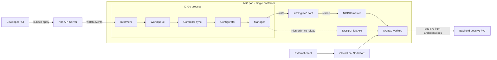

<!-- Generated by scripts/gen-docs.mjs from src/data/*.js. Edit those files, then run `npm run docs`. -->

# Component Reference

What each part of an F5 NGINX Ingress Controller deployment does, from the Kubernetes objects it watches to the NGINX processes that serve traffic.



**Contents**

- Kubernetes objects
  - [Kubernetes API Server (and etcd)](#api)
  - [Ingress and IngressClass](#ingress)
  - [Service (ClusterIP)](#svc)
  - [EndpointSlice](#endpointslice)
  - [Deployment and backend Pods (v1 / v2)](#pods)
  - [Secret (TLS, JWK, CA)](#secret)
  - [NIC ConfigMap (nginx-config)](#configmap)
  - [NIC Service (LoadBalancer / NodePort) and cloud LB](#lb)
- NIC custom resources (k8s.nginx.org/v1)
  - [VirtualServer](#vs)
  - [VirtualServerRoute](#vsr)
  - [Policy](#policy)
  - [GlobalConfiguration](#gc)
  - [TransportServer](#ts)
- Ingress Controller (IC) process: the Go control plane
  - [Informers and Listers](#informer)
  - [Workqueue (task queue)](#workqueue)
  - [Controller sync handler (LoadBalancerController)](#controller)
  - [Configurator](#configurator)
  - [Manager](#manager)
  - [Status updater and leader election](#status)
  - [Metrics exporter](#exporter)
- NGINX processes and files (inside the same container)
  - [Config files (/etc/nginx)](#conf)
  - [NGINX master process](#master)
  - [NGINX worker processes](#workers)
  - [NGINX Plus REST API and live dashboard](#plusapi)
- Outside the cluster
  - [Developer / CI (kubectl apply)](#developer)
  - [External client](#client)

## Kubernetes objects

Standard Kubernetes resources that NIC watches or depends on.

<a id="api"></a>

### Kubernetes API Server (and etcd)

The front door to the cluster. kubectl and the NIC controller both talk to it. It stores every object in etcd and streams watch events (ADDED, MODIFIED, DELETED) to clients.

NIC never receives manifests directly. It opens watches through the API server for every resource type it cares about, and it writes status back (for example VirtualServer State: Valid and the external IP of an Ingress).

| | |
|---|---|
| **In** | kubectl apply / Helm / GitOps writes |
| **Out** | Watch events to the NIC informers; status updates from NIC |

```bash
kubectl get vs,vsr,ts,policy -A
kubectl describe vs cafe
```

<a id="ingress"></a>

### Ingress and IngressClass

The built-in Kubernetes L7 routing resource: host and path rules that point to Services, with optional TLS. ingressClassName chooses which controller handles it (NIC uses the "nginx" class by default).

NIC turns each Ingress into conf.d/<namespace>-<name>.conf. Anything beyond host and path (rewrites, timeouts, canaries) needs nginx.org/* annotations, which are untyped strings. That is the main reason the NIC CRDs exist.

| | |
|---|---|
| **In** | Developer manifests |
| **Out** | A server block per host in the generated config |

```bash
kubectl get ingressclass
kubectl get ingress -A
```

<a id="svc"></a>

### Service (ClusterIP)

A stable name and virtual IP for a set of pods chosen by a label selector. VirtualServer upstreams refer to a Service and port.

By default NIC does not send traffic to the ClusterIP. It reads the Service's EndpointSlices and load balances straight to the pod IPs, which gives it per-pod health, load-balancing methods and session persistence. Set use-cluster-ip: true on an upstream to go through kube-proxy instead.

| | |
|---|---|
| **In** | Pod labels via selector |
| **Out** | EndpointSlices that list ready pod IPs |

```bash
kubectl get svc coffee-svc
kubectl get endpointslices -l kubernetes.io/service-name=coffee-svc
```

<a id="endpointslice"></a>

### EndpointSlice

The list of ready pod IPs and ports behind a Service. It changes every time a pod starts, stops, or passes or fails its readiness probe.

This is the most frequently changing input to NIC. With NGINX Open Source, each change rewrites the upstream "server" lines and reloads NGINX. With NGINX Plus, the IC pushes the change through the Plus API and nothing reloads. Autoscaling and rolling updates are the usual sources of churn.

| | |
|---|---|
| **In** | Pod readiness |
| **Out** | Upstream membership in NGINX |

```bash
kubectl get endpointslices -w
```

<a id="pods"></a>

### Deployment and backend Pods (v1 / v2)

Your application. In the canary labs, coffee-v1 is the stable release and coffee-v2 is the new one. Each has its own Deployment and Service.

Only Ready pods appear in EndpointSlices, so readiness probes decide when a pod gets traffic. If an upstream has no ready pods, NGINX returns 502 Bad Gateway, which you can trigger in the canary lab by scaling v2 to 0.

| | |
|---|---|
| **In** | Requests proxied by NGINX workers |
| **Out** | Responses |

```bash
kubectl scale deploy coffee-v2 --replicas=2
kubectl rollout status deploy/coffee-v2
```

<a id="secret"></a>

### Secret (TLS, JWK, CA)

Holds TLS certificates (kubernetes.io/tls), JWT signing keys (nginx.org/jwk), CA bundles for mTLS (nginx.org/ca) and OIDC client secrets.

The Manager writes referenced Secrets to /etc/nginx/secrets/ inside the pod and points directives such as ssl_certificate or auth_jwt_key_file at them. If a referenced Secret is missing or invalid, the VirtualServer gets a Warning state and NGINX rejects the affected requests.

| | |
|---|---|
| **In** | Certificates and keys you create (for example with cert-manager) |
| **Out** | Files under /etc/nginx/secrets |

```bash
kubectl create secret tls cafe-tls --cert=c.crt --key=c.key
```

<a id="configmap"></a>

### NIC ConfigMap (nginx-config)

Global NGINX settings for the whole controller: worker-processes, worker-shutdown-timeout, proxy-buffering, log formats, OpenTelemetry (otel-*) and more.

The Configurator renders the main /etc/nginx/nginx.conf from this ConfigMap and the nginx.tmpl template. A change here reloads NGINX. It is where several community ingress-nginx annotations end up after migration.

| | |
|---|---|
| **In** | Platform team settings |
| **Out** | The main nginx.conf |

```bash
kubectl -n nginx-ingress edit cm nginx-config
```

<a id="lb"></a>

### NIC Service (LoadBalancer / NodePort) and cloud LB

How traffic from outside the cluster reaches the NIC pods. A cloud load balancer, or a NodePort on each node, forwards ports 80 and 443 (plus any GlobalConfiguration ports) to the NIC replicas.

It is pure L4 forwarding. NIC does all the L7 routing. Use externalTrafficPolicy: Local or PROXY protocol to keep the real client IP, which rate limiting and access control rely on.

| | |
|---|---|
| **In** | Client connections |
| **Out** | Connections to NIC pods |

```bash
kubectl -n nginx-ingress get svc nginx-ingress
```

## NIC custom resources (k8s.nginx.org/v1)

Typed resources added by F5 NGINX Ingress Controller. They are validated by the IC before any config is generated.

<a id="vs"></a>

### VirtualServer

The L7 configuration for one host: TLS, upstreams (Service, port and load-balancing settings), and routes with actions, splits, matches, error pages, policies and snippets.

The Configurator renders it to conf.d/vs_<namespace>_<name>.conf. splits become split_clients, matches become map blocks, and each upstream becomes an upstream block. Invalid resources are rejected with State: Invalid and the old config keeps serving.

| | |
|---|---|
| **In** | Developer manifest; Services; Secrets; Policies |
| **Out** | server, location, upstream, split_clients and map blocks |

```bash
kubectl get vs cafe -o jsonpath="{.status.state}"
```

<a id="vsr"></a>

### VirtualServerRoute

A set of subroutes that a VirtualServer delegates to, often in another namespace and owned by another team.

The VS route says route: <namespace>/<vsr-name>. The VSR must use the same host, and each subroute path must start with the delegated path. NIC merges both into the same server block, so teams can own their paths while RBAC stays per namespace.

| | |
|---|---|
| **In** | Delegation from a VirtualServer |
| **Out** | location blocks inside the parent server |

```bash
kubectl -n tea-team get vsr
```

<a id="policy"></a>

### Policy

A reusable traffic or security rule with exactly one type: rateLimit, jwt, oidc, ingressMTLS, egressMTLS, accessControl, basicAuth, apiKey or waf.

A Policy does nothing until a VirtualServer or VirtualServerRoute references it in spec.policies (the whole server) or routes[].policies (one location). It compiles to NGINX directives (limit_req, auth_jwt, allow/deny, ssl_verify_client, app_protect_*) that the workers enforce. jwt and oidc need NGINX Plus, and waf needs F5 WAF for NGINX.

| | |
|---|---|
| **In** | References from VS / VSR |
| **Out** | Directives in server or location blocks |

```bash
kubectl get policy
kubectl describe policy rate-limit-policy
```

<a id="gc"></a>

### GlobalConfiguration

A single, cluster-wide resource that declares extra listeners (name, port, protocol TCP or UDP) for L4 traffic.

The IC only reads the one named by the -global-configuration=<namespace>/<name> argument. Each listener becomes a listen socket in the stream context. You also need to expose those ports on the NIC Service.

| | |
|---|---|
| **In** | Platform team manifest |
| **Out** | Listen sockets for TransportServers |

```bash
kubectl -n nginx-ingress get globalconfiguration
```

<a id="ts"></a>

### TransportServer

L4 (TCP/UDP) load balancing, or TLS passthrough, for one listener.

It claims a GlobalConfiguration listener by name and protocol (or the built-in tls-passthrough listener with a host for SNI routing). It renders to stream-conf.d/ts_<namespace>_<name>.conf with upstream, server and proxy_pass in the stream context.

| | |
|---|---|
| **In** | Listener from GlobalConfiguration; Services |
| **Out** | stream { } server and upstream blocks |

```bash
kubectl get ts
```

## Ingress Controller (IC) process: the Go control plane

The Go program that runs as the main process in the NIC container. It turns Kubernetes state into NGINX config.

<a id="informer"></a>

### Informers and Listers

client-go components that watch the API server for each resource type and keep an in-memory cache of the objects.

Event handlers compare the old and new object, ignore changes that do not matter (such as status-only updates), and add the key of the affected resource to the workqueue. Listers then read from the cache, so building config never needs another API call.

| | |
|---|---|
| **In** | Watch streams from the API server |
| **Out** | Keys added to the workqueue |

```bash
-watch-namespace=<ns> limits what is watched
```

<a id="workqueue"></a>

### Workqueue (task queue)

A rate-limited FIFO queue of work items such as "VirtualServer default/cafe" or "Endpoints default/coffee-svc".

Duplicate keys collapse while they wait, so ten quick edits to one resource produce one sync. When a lot of work arrives together (startup, or a large GitOps apply) the controller handles it as a batch and reloads once at the end. Failed items are retried with backoff.

| | |
|---|---|
| **In** | Keys from informers |
| **Out** | One item at a time to the sync handler |

```bash
Watch the workqueue depth metric for backlogs
```

<a id="controller"></a>

### Controller sync handler (LoadBalancerController)

The loop that takes items off the workqueue and decides what each one affects. For example, a Service change can affect several VirtualServers.

It gathers every related object from the listers, validates CRDs, and records warnings or errors as Kubernetes Events and resource status. It then hands the result to the Configurator.

| | |
|---|---|
| **In** | Workqueue items; lister cache |
| **Out** | Validated resource bundles for the Configurator; Events and status |

```bash
kubectl get events --field-selector involvedObject.kind=VirtualServer
```

<a id="configurator"></a>

### Configurator

Turns validated resources into NGINX configuration.

It builds an internal config model (servers, locations, upstreams, policies) and renders it with Go templates: nginx.tmpl for the main file, nginx.virtualserver.tmpl and nginx.transportserver.tmpl for the CRDs. It also decides whether a change needs a reload or, on NGINX Plus, only an API call to update endpoints.

| | |
|---|---|
| **In** | Resource bundles from the controller |
| **Out** | Config text and endpoint lists for the Manager |

```bash
Custom templates can be set through the ConfigMap
```

<a id="manager"></a>

### Manager

The only part of the IC that touches NGINX.

It writes config files and secrets to disk, starts the NGINX master at boot, and reloads it (nginx -s reload) when the config changes, waiting for the new config to be applied. On NGINX Plus it calls the REST API to add or remove upstream servers without a reload.

| | |
|---|---|
| **In** | Rendered config; endpoint changes |
| **Out** | Files under /etc/nginx; reload signals; Plus API calls |

```bash
kubectl exec -n nginx-ingress <pod> -- nginx -T
```

<a id="status"></a>

### Status updater and leader election

Writes the external address and validation state back to Ingress, VirtualServer and TransportServer objects.

With several NIC replicas, leader election (on by default) picks one replica to write status, so they do not overwrite each other. Every replica still builds its own NGINX config independently.

| | |
|---|---|
| **In** | Results of each sync |
| **Out** | status fields on resources |

```bash
kubectl get vs -o wide
```

<a id="exporter"></a>

### Metrics exporter

A Prometheus endpoint (enabled with -enable-prometheus-metrics, default port 9113) that exposes controller and NGINX metrics.

Controller metrics include reload counts and timing, reload errors, resource counts and workqueue statistics. NGINX metrics come from stub_status on OSS, or from the much richer Plus API on NGINX Plus (per zone and per upstream server). -enable-latency-metrics adds upstream latency histograms.

| | |
|---|---|
| **In** | IC internal counters; NGINX status |
| **Out** | /metrics for Prometheus |

```bash
curl <pod-ip>:9113/metrics | grep reloads_total
```

## NGINX processes and files (inside the same container)

The data plane. These processes serve the traffic.

<a id="conf"></a>

### Config files (/etc/nginx)

nginx.conf (main config from the ConfigMap), conf.d/*.conf (one per Ingress or VirtualServer), stream-conf.d/*.conf (TransportServers) and secrets/ (certificates and keys).

They are generated by the Configurator and written by the Manager. Never edit them by hand, because the IC overwrites them on the next sync. Dump the full running config with nginx -T.

| | |
|---|---|
| **In** | Manager writes |
| **Out** | Config the NGINX master reads on reload |

```bash
kubectl exec <pod> -- ls /etc/nginx/conf.d
kubectl exec <pod> -- nginx -T
```

<a id="master"></a>

### NGINX master process

The parent NGINX process. It reads the config, binds the listen sockets, and starts and supervises the workers. It does not handle requests itself.

On a reload it parses the new config. If the config is valid, it starts a new generation of workers and tells the old generation to stop accepting connections and exit once their in-flight requests finish (capped by worker-shutdown-timeout). If the config is invalid, the old workers keep running unchanged.

| | |
|---|---|
| **In** | Config files; reload signal from the Manager |
| **Out** | Worker processes |

```bash
kubectl exec <pod> -- ps -ef | grep nginx
```

<a id="workers"></a>

### NGINX worker processes

The processes that handle traffic, one per CPU core by default (worker-processes). Each one runs an event loop that handles thousands of connections.

For each request a worker picks the server by Host or SNI and then the location by path. It runs policy checks in phase order (mTLS during the handshake, limit_req, allow/deny, auth_jwt, WAF), chooses an upstream through split_clients or map, and proxies straight to a pod IP. Rejections such as 429, 401 and 403 happen here.

| | |
|---|---|
| **In** | Client connections |
| **Out** | Proxied requests to pods; responses |

```bash
Access log: kubectl logs <pod>
```

<a id="plusapi"></a>

### NGINX Plus REST API and live dashboard

NGINX Plus only. An HTTP API that lets you read live metrics and change upstream servers at runtime, plus a dashboard (port 8080, /dashboard.html) built on it.

Upstreams use shared-memory zones, so the IC can add or remove pod IPs through the API without rewriting files or reloading. Connections stay open, memory stays flat, and reload storms from endpoint churn disappear.

| | |
|---|---|
| **In** | Calls from the Manager |
| **Out** | Live upstream membership; metrics |

```bash
kubectl port-forward <pod> 8080:8080  # then open /dashboard.html
```

## Outside the cluster

Actors at either end of the two flows.

<a id="developer"></a>

### Developer / CI (kubectl apply)

Where config changes start: a person running kubectl, a Helm release, or a GitOps tool such as Argo CD or Flux.

Everything goes through the API server. Large automated applies are a common cause of reload bursts, which is what the Reload Storm lab models.

| | |
|---|---|
| **In** | YAML manifests |
| **Out** | API writes |

```bash
kubectl apply -f cafe-vs.yaml
```

<a id="client"></a>

### External client

A browser, mobile app, API consumer, or L4 client (DNS, database) sending traffic to the ingress address.

The Host header or SNI chooses the VirtualServer, the path chooses the route, and headers, cookies or arguments can drive matches. For example, X-Beta-User: true sends a request to v2 in the canary lab.

| | |
|---|---|
| **In** | - |
| **Out** | HTTP(S), gRPC, TCP or UDP traffic |

```bash
curl -H "Host: cafe.example.com" -H "X-Beta-User: true" http://<lb-ip>/coffee
```

